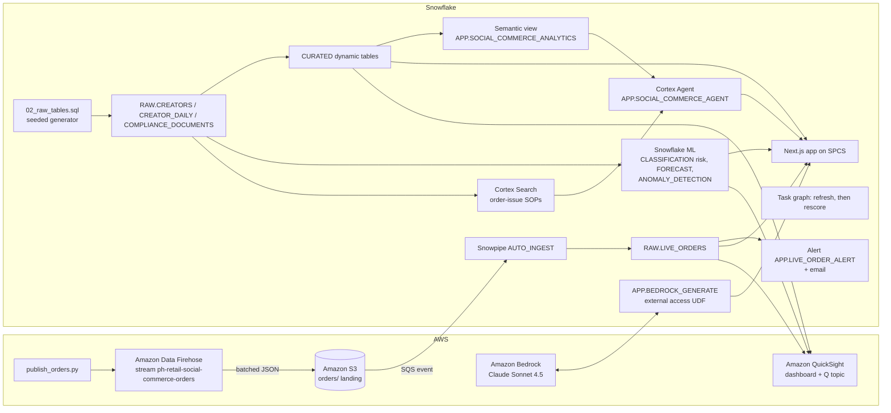

# Philippines Retail Social Commerce - Live-Selling Orders and Returned-to-Sender Risk

End-to-end social commerce operations for **40 fictional live-selling creators who sell a fictional Philippine retail brand's products from 5 cities** (Quezon City, Cebu City, Davao City, Iloilo City, Cagayan de Oro) using Snowflake, optionally with AWS: from a live order issue to a 7-day returned-to-sender (RTS) risk score, an alert email and an AI action memo for the social commerce operations team.

## Architecture

A social commerce operations pipeline built on **Snowflake** (Dynamic Tables, Snowflake ML, Cortex Search, Cortex Agent, Cortex AI_COMPLETE, SPCS) and, in the full build, **AWS** (Amazon Data Firehose, S3, Bedrock Claude, QuickSight + Amazon Q). Livestream and short-video shop order events land in `RAW.LIVE_ORDERS`. Dynamic tables curate 90 days of creator-day history: orders, GMV in PHP, order issues raised, RTS orders (parcels sent back after a refused or failed delivery, including cash-on-delivery refusals), late deliveries, clean order rate and catalog sync compliance. Snowflake ML scores 7-day RTS risk per creator, forecasts network-wide order-issue volume and flags return rate anomalies. A Cortex Agent answers questions with SOP citations, and an LLM drafts the operations action memo.

Interactive diagrams (hover for object names): [Snowflake only](docs/architecture-snowflake.html) | [AWS + Snowflake](docs/architecture-aws.html). The app shows both on its Architecture & Data tab, the current build first. Regenerate them with `python3 docs/build_architecture.py`.



The Snowflake-only build drops the AWS subgraph: `APP.SIMULATE_ORDERS` writes to `RAW.LIVE_ORDERS`, and the app calls Cortex `AI_COMPLETE` instead of the Bedrock UDF.

## Snowflake Capabilities

| Capability | Implementation |
|-----------|---------------|
| Dynamic Tables | `CURATED.KPI_SUMMARY`, `PERFORMANCE_SUMMARY`, `ISSUE_SUMMARY`, `TREND_ANALYSIS` from the RAW tables |
| Snowflake ML | CLASSIFICATION 7-day RTS risk (`ML.RTS_RISK_SCORES`), 14-day order-issue FORECAST, return rate ANOMALY_DETECTION |
| Cortex Search | 14 synthetic order-issue handling SOPs (one per product category and issue type) in `SEARCH.ISSUE_SOP_SEARCH` |
| Semantic View | `APP.SOCIAL_COMMERCE_ANALYTICS` over creators, issue types, daily totals and risk |
| Cortex Agent | `APP.SOCIAL_COMMERCE_AGENT`: Cortex Analyst over the semantic view plus Cortex Search for SOP citations |
| Cortex AI | `AI_COMPLETE('claude-sonnet-4-5')` for grounded answers, and for the action memo in the Snowflake-only build |
| Alerts + Tasks | `APP.LIVE_ORDER_ALERT` logs ISSUE events and sends email; task graph `TASK_REFRESH_CURATED`, then `TASK_RESCORE_RISK` |
| Snowpark Container Services | Next.js app `APP.PH_RETAIL_SOCIAL_COMMERCE_APP` with 6 tabs: Executive Cockpit, Predictive, Controls, Live Orders, Ask AI, Architecture & Data |
| Snowpipe | `RAW.LIVE_ORDERS_PIPE` AUTO_INGEST from S3 (AWS build only) |

## AWS Services

Used only in the AWS + Snowflake build. Order events are an event stream, so they go through Amazon Data Firehose rather than a device service.

| Service | Role in Demo |
|---------|-------------|
| Amazon Data Firehose | Direct PUT stream `ph-retail-social-commerce-orders` receives simulated livestream order events and writes batches to S3 |
| Amazon S3 | Landing bucket (`orders/`). An event notification goes to the Snowpipe SQS queue |
| Amazon Bedrock | Claude Sonnet 4.5 writes the action memo, called from Snowflake through an external-access UDF |
| Amazon QuickSight | DIRECT_QUERY executive dashboard over Snowflake (daily order issues, RTS orders by creator, RTS risk) |
| Amazon Q | Natural-language questions over the QuickSight topic `ph-retail-social-commerce-topic` |
| AWS IAM | Least-privilege roles for S3, Firehose and Bedrock |

## Personas

These personas are fictional.

| Persona | Role | Key Questions |
|---------|------|---------------|
| **Andrea Villanueva** | Head of Social Commerce Operations | "What is our clean order rate?" "Which issue types end as returned-to-sender orders?" |
| **Joaquin dela Cruz** | Creator Quality Analyst | "Which live-selling creators are high RTS risk this week, and which SOP applies?" |

## Data

All data is synthetic and seeded, so every rebuild reproduces it. The retail brand, creators and names are fictional; the cities are real Philippine cities used as regions. Data is aggregated per creator and day, with no buyer-level records.

| Table | Rows | Description |
|-------|------|-------------|
| RAW.CREATORS | 40 | Live-selling creators in 5 cities and 5 categories (Fashion, Gadgets, Home and kitchen, Beauty and personal care, Snacks and pantry), with fulfilment risk tier and tenure |
| RAW.CREATOR_DAILY | 3,600 | Daily creator observations over 90 days: orders, GMV (PHP), order issues, RTS orders, late deliveries, issue type, catalog syncs, return rate and time to dispatch |
| RAW.COMPLIANCE_DOCUMENTS | 40 | Required, on-file and pending creator documents (for example the brand affiliate agreement) per creator |
| SEARCH.ISSUE_DOCS | 14 | Synthetic order-issue handling SOPs indexed for Cortex Search |
| RAW.LIVE_ORDERS | Grows during the demo | Live order events from Firehose (AWS build) or `APP.SIMULATE_ORDERS` (Snowflake-only build) |
| ML.RTS_RISK_SCORES | 40 | 7-day RTS probability and risk band per creator |

## Build Instructions

### Prerequisites
- Snowflake account with ACCOUNTADMIN access, and Cortex AI enabled (AI_COMPLETE, Search, Agent).
- An X-Small warehouse with auto-suspend at or below 120 s, and an existing SPCS compute pool.
- Python 3.11+, `snowflake-connector-python`, Node.js 22+, Docker and the `snow` CLI.
- App image: run `snow spcs image-registry login`, then build and push `ph-retail-social-commerce-app:v1` to the database's `APP.IMAGES` repository (see the header of `snowflake/07_deploy_app.sql`).
- AWS build only: `boto3`, AWS credentials for the target account (us-west-2) with Bedrock access, and QuickSight Enterprise.

### SPCS App
```
<DATABASE>.APP.PH_RETAIL_SOCIAL_COMMERCE_APP
```

### Tests
```bash
python -m pytest aws snowflake quicksight
```

For a local run, put `SNOWFLAKE_ACCOUNT`, `SNOWFLAKE_USER`, `SNOWFLAKE_DATABASE`, `SNOWFLAKE_WAREHOUSE`, `SNOWFLAKE_AUTHENTICATOR=PROGRAMMATIC_ACCESS_TOKEN`, `SNOWFLAKE_TOKEN` and `DEMO_PLATFORM` in the environment, then run `npm --prefix app run build && npm --prefix app start`.

## Build Modes

Both modes share the same core. They differ in three places, and the app's `DEMO_PLATFORM` setting (in its SPCS spec) switches the memo provider and the Live Orders tab.

| Layer | Snowflake Only | Full AWS + Snowflake |
|---|---|---|
| Live orders | `CALL APP.SIMULATE_ORDERS(n)` inserts simulated order events into `RAW.LIVE_ORDERS`. This simulates an order feed; it is not Snowpipe Streaming | `aws/publish_orders.py` to Amazon Data Firehose, then S3, SQS and Snowpipe AUTO_INGEST |
| Action memo | Cortex `AI_COMPLETE('claude-sonnet-4-5')` | Amazon Bedrock Claude Sonnet 4.5 through `APP.BEDROCK_GENERATE` |
| BI and natural-language questions | The SPCS app is the dashboard; questions go to the Cortex Agent | Also a QuickSight dashboard and an Amazon Q topic |
| App setting | `DEMO_PLATFORM: snowflake` | `DEMO_PLATFORM: aws` |

### Snowflake Only

```bash
# 1. Core data and dynamic tables (guarded: new isolated database only)
python snowflake/run_core.py --database PHILIPPINES_RETAIL_SOCIAL_COMMERCE_SNOWFLAKE --warehouse <XS_WAREHOUSE> --connection <CONNECTION> --apply
# 2. Native order feed, ML, search, semantic view, agent, alert and task graph
python snowflake/run_intelligence.py --database PHILIPPINES_RETAIL_SOCIAL_COMMERCE_SNOWFLAKE --platform snowflake --warehouse <XS_WAREHOUSE> --connection <CONNECTION> --alert-email you@example.com
# 3. App on SPCS with DEMO_PLATFORM=snowflake (push the image first)
python snowflake/run_intelligence.py --database PHILIPPINES_RETAIL_SOCIAL_COMMERCE_SNOWFLAKE --platform snowflake --warehouse <XS_WAREHOUSE> --connection <CONNECTION> --alert-email you@example.com --files 07_deploy_app.sql --compute-pool <COMPUTE_POOL>
```

During the demo:
- Run `CALL APP.SIMULATE_ORDERS(20)` to add live order events. For a continuous feed, run `ALTER TASK APP.TASK_SIMULATE_ORDERS RESUME`, and `SUSPEND` it afterwards.
- Run `EXECUTE ALERT APP.LIVE_ORDER_ALERT` to raise the alert email.
- Run `EXECUTE TASK APP.TASK_REFRESH_CURATED` to refresh the curated tables and rescore risk.

Afterwards, drop the database or run `ALTER SERVICE APP.PH_RETAIL_SOCIAL_COMMERCE_APP SUSPEND`.

### Full AWS + Snowflake

```bash
# 1. Core data and dynamic tables (guarded: new isolated database only)
python snowflake/run_core.py --database PHILIPPINES_RETAIL_SOCIAL_COMMERCE_AWS --warehouse <XS_WAREHOUSE> --connection <CONNECTION> --apply
# 2. AWS ingestion and Bedrock (dry run first, then --apply)
python aws/setup_aws.py --database PHILIPPINES_RETAIL_SOCIAL_COMMERCE_AWS --account <AWS_ACCOUNT_ID> --connection <CONNECTION> --apply
# 3. ML, search, semantic view, agent, alert and task graph
python snowflake/run_intelligence.py --database PHILIPPINES_RETAIL_SOCIAL_COMMERCE_AWS --platform aws --warehouse <XS_WAREHOUSE> --connection <CONNECTION> --alert-email you@example.com
# 4. App on SPCS with DEMO_PLATFORM=aws (push the image first)
python snowflake/run_intelligence.py --database PHILIPPINES_RETAIL_SOCIAL_COMMERCE_AWS --platform aws --warehouse <XS_WAREHOUSE> --connection <CONNECTION> --alert-email you@example.com --files 07_deploy_app.sql --compute-pool <COMPUTE_POOL>
# 5. QuickSight dashboard and Q topic (needs an existing Snowflake data source)
python quicksight/build_dashboards.py --database PHILIPPINES_RETAIL_SOCIAL_COMMERCE_AWS --account <AWS_ACCOUNT_ID> --principal-arn <QUICKSIGHT_USER_ARN> --data-source-arn <DATA_SOURCE_ARN> --prefix ph-retail-social-commerce --apply --update --with-topic
```

QuickSight objects must be shared with the QuickSight user who signs in (`--principal-arn`); otherwise the console shows nothing.

During the demo:
- Run `python aws/publish_orders.py --count 20` to send live order events. Firehose buffers for up to 60 seconds before writing to S3.
- Run `EXECUTE ALERT APP.LIVE_ORDER_ALERT` to raise the alert email.
- Run `EXECUTE TASK APP.TASK_REFRESH_CURATED` to refresh the curated tables and rescore risk.

Afterwards, `python aws/teardown_aws.py --database PHILIPPINES_RETAIL_SOCIAL_COMMERCE_AWS --account <AWS_ACCOUNT_ID> --connection <CONNECTION> --apply` removes the AWS resources and the account-level Bedrock external-access and S3 storage integrations. It leaves the email integration `PH_RETAIL_SOCIAL_COMMERCE_EMAIL_INT`, which the Snowflake-only build also uses.

## Business Impact

Industry research and Snowflake customer outcomes:
- **Philippine digital growth is led by e-commerce**: "Philippines continues its double-digit growth across all core sectors, driven by e-commerce" -- [Google, Temasek and Bain & Company, e-Conomy SEA 2024 report](https://services.google.com/fh/files/misc/e_conomy_sea_2024_report.pdf)
- **Video commerce is driving e-commerce growth in Southeast Asia**: "Video commerce has experienced rapid growth, contributing to increased GMV and customer acquisition." -- [Google, Temasek and Bain & Company, e-Conomy SEA 2024 report](https://services.google.com/fh/files/misc/e_conomy_sea_2024_report.pdf)
- **Tapestry** (Snowflake customer, house of Coach, Kate Spade and Stuart Weitzman): "On a daily basis, Tapestry processes about 4 billion rows and runs over 100 major data processes", and "We've roughly doubled our data sources, and yet we have achieved significant cost savings from our legacy solution" -- [Snowflake customer story: Tapestry](https://www.snowflake.com/en/customers/all-customers/case-study/tapestry/)

## Key Demo Numbers

These figures are synthetic and come from the seeded demo data. Forecast and anomaly figures can shift slightly with the build day.

- **40 live-selling creators** in 5 Philippine cities across 5 categories, 3,600 creator-days over 90 days; **751,364 orders** worth PHP 548 M GMV
- **Clean order rate 99.92%**: **591 order issues** raised, of which **187** ended as RTS orders (issue RTS rate 31.6%); **77 late deliveries**
- **COD refused at door** issues have the highest RTS share (32 of 60 issues, 53.3%); **Damaged in transit** produces the most RTS orders (38 of 121 issues); the 16 courier network disruption issues (Iloilo City and Cagayan de Oro) are always resolved without an RTS order
- **Cebu City** creators have the fewest RTS orders (14); **Davao City** the most (49)
- **RTS model** out-of-time holdout: precision 0.54, recall 0.34 at a 0.5 threshold, against a 0.21 base rate. Four creators are high risk; the top creator is CRT-0017, at 96.9%
- **14-day order-issue forecast** with prediction intervals; **45 of 640** creator-days flagged as return rate anomalies
- **Catalog sync compliance 77.9%**, creator document coverage 54.9%, with 23 documents pending
- **14 SOPs** indexed for Cortex Search and cited by ID in agent answers

## License

Apache 2.0 — See [LICENSE](LICENSE) for details.

This is a personal demo project and is not an official Snowflake offering. It comes with no support or warranty. Industry metrics cited are from publicly available third-party research and Snowflake customer stories; they represent reported outcomes and are not guarantees of results.
